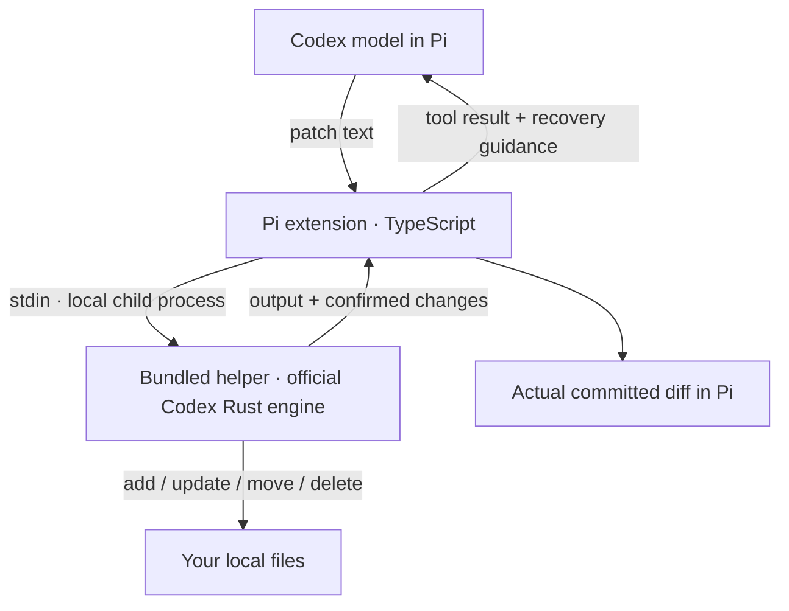

# @runminton/pi-apply-patch

I use this plugin every day. Its goal is to bring Codex's native `apply_patch` editing experience to Pi as closely as practical, using the official Codex Rust patch engine rather than maintaining a second patch implementation.

**This is an unofficial integration, not the Codex CLI or a complete reproduction of Codex Core.**

The useful addition is explicit recovery information: if an earlier operation succeeds and a later one fails, the completed changes remain on disk. The tool reports confirmed operations so the Agent can correct the failed and not-yet-executed work without blindly repeating successful edits. Partial application comes from the official engine; this plugin makes that state visible. The call still reports an error, and incomplete records explicitly ask the Agent to inspect files.

## Install

**Supported platform: macOS on Apple Silicon (`darwin`, `arm64`) only.**

With Pi already installed:

```bash
pi install npm:@runminton/pi-apply-patch@1.0.0
```

Restart Pi after installation. Pi manages the package under its npm directory (normally `~/.pi/agent/npm`) and records it in `~/.pi/agent/settings.json`. Add `-l` for a project-local declaration in `.pi/settings.json`; Pi's project trust rules apply.

**You do not need Codex CLI, Rust, Cargo, or a Codex source checkout on your computer.** The npm package includes a precompiled helper. Installation does not compile Rust, download a separate helper, or run an install/postinstall script. Pi supplies its own runtime packages.

If you prefer to manage the npm dependency yourself:

```bash
npm install --legacy-peer-deps @runminton/pi-apply-patch@1.0.0
pi install ./node_modules/@runminton/pi-apply-patch
```

`npm install` alone does not enable the extension in Pi. This alternative writes to the current npm project; the second command registers its local package path with Pi.

## How it works



For each call, the extension starts the helper without a shell in Pi's current working directory. It passes the patch unchanged. The official library parses the patch and edits files; the modified CLI entry point returns execution records to the extension. There is no background service.

The helper runs with your user permissions and inherits Pi's environment. Relative paths resolve from Pi's working directory; **this is not a sandbox or a restriction to that directory**. A patch can address absolute paths or paths outside the project. This plugin supplies no separate approval dialog, backup, or rollback.

## When it activates

The extension checks the selected model at session start and on model changes:

| Selected provider | Behavior |
| --- | --- |
| `openai-codex` | Enable `apply_patch`; disable Pi's built-in `write` and `edit`. Leave `read` and other tools unchanged. |
| Any other provider, including `openai` | Keep `apply_patch` inactive; restore whichever of `write` and `edit` were active before entering Codex. |

Activation is based on the provider ID, not merely a model name containing “Codex”. Do not load the legacy plugin or another `apply_patch` extension alongside this one.

If the helper is missing, not executable, or the platform is unsupported, Pi shows an error and leaves `apply_patch` inactive. **In Codex sessions, `write` and `edit` still remain disabled.** Reinstall on a supported host, or remove the plugin and restart Pi to return to ordinary editing tools. There is no fallback to Codex CLI or the old TypeScript engine.

### What the model receives

The extension does not replace Pi's system prompt or edit your prompt files. It does contribute to the effective prompt through Pi's standard tool registration:

- An `apply_patch` tool description, parameter schema, and Codex Lark grammar for native freeform calls.
- A tool summary and guidelines to use `apply_patch` for local file edits, avoid shell-based file writing, allow formatters and bulk mechanical rewrites, and recover using confirmed operations instead of replaying them.
- Failure output preserving the original error and adding confirmed changes or an explicit warning when the record is incomplete or unavailable.

Pi incorporates active tool summaries/guidelines into its system prompt and handles grammar-capable model serialization. This changes the tools and instructions available to the model; it is not a separate hidden prompt rewrite. In codemode, the call form is `tools.apply_patch({ patch })`.

### What changes on your computer

Apart from package-manager files and Pi's package registration, the extension does not modify Pi Core, an existing Codex installation, shell profiles, system settings, or your `AGENTS.md` files. It does not install a daemon, add telemetry, or make its own network requests. File changes happen when the tool executes a patch.

Pi and npm still perform their normal installation/network operations, and Pi still sends normal model requests using your configured provider.

### Privacy and session data

Patches and model-facing tool output (including paths, errors, and recovery summaries) are part of the Pi conversation and can be sent to the configured model provider. Normal helper results also give the extension before/after text locally to compute actual diffs.

The extension retains compact diffs, paths, counts, and execution metadata in tool-result `details`, not normal full-file snapshots. Pi can persist those details in session files, including changed text in diffs. The model-facing result does not add the diff snapshots, but this is not a promise that file text never reaches the model: patches, errors, and subsequent `read` calls can contain it. Malformed helper stdout is retained in diagnostic details and may also contain file text.

There is no separate plugin upload service or telemetry. Removing the plugin does not delete Pi's existing session history.

## Stop using it

For a Pi-managed npm installation:

```bash
pi remove npm:@runminton/pi-apply-patch@1.0.0
```

Use the source shown by `pi list` if you installed a different version or source. Include `-l` if it was registered project-locally. Restart Pi after removal; this also avoids relying on tool activation state retained by an already-running session.

For the manual npm/local-path installation above:

```bash
pi remove ./node_modules/@runminton/pi-apply-patch
npm uninstall --legacy-peer-deps @runminton/pi-apply-patch
```

To temporarily disable it without uninstalling, deselect its extension with `pi config`, then restart Pi. Uninstalling or disabling does not revert edited files or erase session history.

## Upgrading from 0.1.0

1.0.0 replaces the locally maintained TypeScript engine with the pinned official Rust library. It is an intentionally breaking replacement under the same package name:

- macOS arm64 only, rather than the previous pure-TypeScript distribution.
- Only `openai-codex` activates the tool, rather than both OpenAI Responses API families.
- Both `write` and `edit` are disabled under Codex; the old plugin replaced only `edit`.
- Official standalone-engine sequential execution, without the old whole-patch preflight or per-file mutation queues. Later failures can leave earlier changes committed.
- Diffs reflect recorded committed changes, not an execution-beforehand preview.

The old implementation is archived on `legacy` and fixed at `legacy-v0.1.0`. These refs are archival, not a promise of ongoing maintenance. Existing npm version 0.1.0 is not unpublished. To stay on it, remove your current Pi package registration, then install `npm:@runminton/pi-apply-patch@0.1.0` and restart Pi. Do not keep both versions registered.

## Developer reference

The following sections describe the pinned source build, internal protocol, and verification boundaries. End users installing the npm package do not need the build prerequisites.

## Build the pinned helper

Run from this extension's directory:

```bash
npm run build
```

The build archives commit `c22a06c18070c3e33bd2648c7210a00a2a9f6f80` from `~/20-dev/90-third-party-repos/codex` into `.build/`, copies `backend/standalone_executable.rs` over the archived command-line entry point, and adds the already-locked `serde_json` dependency. Cargo uses `--locked --offline`. Rust and the dependency cache from the existing official-helper build are required. Set `PI_CODEX_SOURCE` if the source repository is elsewhere.

The original checkout and official executable are not changed. Source/dependency versions stay pinned even if the original checkout advances. Rebuilding requires the pinned commit to remain available locally. The compiled program runs independently of that checkout.

The build keeps `.build/bin/pi-apply-patch` for development and copies a stripped distribution helper to `bin/pi-apply-patch`. The plugin prefers `bin/`, falling back to `.build/bin/` only when the bundled path does not exist. `PI_CODEX_APPLY_PATCH_HELPER_BIN` takes precedence over both and must implement the same JSON protocol; it does not bypass the platform gate. The old `PI_CODEX_APPLY_PATCH_BIN` variable is no longer used by the plugin. There is no fallback to the old standalone executable.

After building, install the source checkout as a local Pi package:

```bash
pi install .
```

Use `/reload` in an existing Pi session after changing this extension. At session start and provider selection, the extension checks that the helper is an executable regular file. If unavailable, it reports the path and leaves `apply_patch` inactive. Under `openai-codex`, `write` and `edit` stay disabled; switching providers restores their prior activation.

To prepare a release tarball, run `npm pack --dry-run` and `npm pack`. The prepack check requires an executable bundled helper. The tarball includes the two TypeScript modules, stripped helper, README/changelog, and license/notice files. Tests, build snapshots, source-build scripts, and host-provided Pi packages are excluded. A git checkout does not include the ignored helper; build it before using a git/local installation.

## Self-modification continuity

This plugin is used to edit and upgrade itself through its own `apply_patch` tool. Between completed editing/build steps, the already-loaded tool must remain usable, including after replacing the helper and before `/reload`. Both successful calls and partial failures must still return valid execution records, so the Agent can recover without repeating committed operations.

Editing TypeScript files leaves the running adapter unchanged until reload. Rebuilding replaces the executable that this adapter starts on its next call. The v1/v2 compatibility in Failure behavior protects this mixed-version state; it is an active self-modification requirement, not merely support for historical session output. Reload activates the edited TypeScript code; it must not be a prerequisite for continuing edits after a helper rebuild.

Keep the existing protocol stable when possible. A protocol change must preserve the records accepted by the supported already-loaded adapter, or provide a verified way for that adapter to keep using a compatible helper. Current decoders reject extra fields, so adding fields to an existing envelope is also a compatibility change. Retiring a protocol requires an explicit decision about the affected running sessions, rather than assuming that the new adapter is the only caller. This does not require supporting every historical version indefinitely.

`test/self-update.test.mjs` protects the transition through a real Pi session: a frozen v1 extension edits its own entry file, the helper at the same path is replaced, the loaded tool succeeds and reports a recoverable partial failure, then `session.reload()` activates the current extension and its v2 diff results. The old-helper baseline is simulated with a v1-only transport around the real Rust engine; replacement uses the built current helper. All replacement and edits occur in a temporary directory. The test exercises completed-step transitions, not concurrent calls during executable replacement or the Cargo build itself.

## Execution path

1. Pi receives the model's `patch` string.
2. The extension starts the helper without a shell, sets its working directory to Pi's `ctx.cwd`, and writes the patch to stdin unchanged.
3. The helper captures the official library's stdout/stderr and returns a JSON envelope on process stdout. Its process exit code remains `0`, `1` or `2`, matching the original entry point.
4. The plugin validates the envelope and exit status. On success it returns only the original `stdout + stderr`, without an added separator. On failure it preserves that original text as a prefix and appends a clearly marked execution-state section. Original streams, exit status and structured changes are retained separately in tool details.
5. Before/after text from the library's committed records is merged by path into one net diff per call. Pi's diff generator computes compact display data once; only those diffs, counts, paths and final-newline notes are retained in `details.diffView`. Full-file snapshots are not retained in valid tool results or passed to the model. A display-data computation error does not change the patch's execution status.

The extension does not trim, summarize, correct, or rewrite the patch or original result text. The failure-only status section is intentionally additional content. Interleaving between stdout and stderr is not preserved. Pi may supply `(no tool output)` for empty results or sanitize invalid Unicode surrogates.

When the selected provider is `openai-codex`, the extension activates its `apply_patch` tool and removes Pi's built-in `write` and `edit` tools from the active tool set. Pi's `read` tool remains available, including for images. The extension remembers which of `write` and `edit` were active and restores them when the selected provider changes away from `openai-codex`. The tool's execute handler also rejects calls when another provider is selected.

The helper runs on the same machine as Pi and uses its local filesystem. This integration does not provide Codex Core's approval or sandbox layer, and it does not route execution to a remote workspace.

### Direct calls and codemode

Direct model calls use the FREEFORM grammar: supply the patch text without a JSON wrapper. Inside codemode, tools take an argument object: use `await tools.apply_patch({ patch })`, where `patch` is the same unchanged string. The tool description distinguishes these entry points, and `describeTool("apply_patch")` exposes the object declaration.

Passing the string directly to `tools.apply_patch(patch)` fails argument validation before the helper runs. This is different from a helper execution failure; earlier calls in the same codemode script may still have completed. `test/codemode.test.mjs` exercises the installed codemode extension and registered patch tool, including the generated guidance, rejected string form and successful object form.

## Failure behavior

File operations still execute in sequence. Earlier writes can remain after a later failure; cancellation and write errors do not imply rollback.

Failure-only output, following the unchanged original error:

```text
Changes already applied (in execution order):
- Wrote: "/workspace/a.txt"
- Updated: "/workspace/b.txt"
- Moved: "/workspace/c.txt" -> "/workspace/d.txt"
```

- Records preserve library order, including multiple operations on the same path.
- Agent-facing labels are `Wrote`, `Updated`, `Deleted` and `Moved`; paths are JSON-quoted to keep embedded quotes/newlines distinct from instructions. `Wrote` reflects the library's `add` operation, which can overwrite an existing file.
- These are completed operations, not a claim that the entire patch or every operation on a listed file succeeded.
- Internal `details.changes.exact` directly reflects the library's `is_exact()`. This flag is not exposed as a model-facing field.
- An incomplete record adds: `The change record may be incomplete. Other changes may have occurred.` followed by `Inspect affected files before retrying.`
- No valid record adds: `Could not determine which changes were applied.` followed by `Files may have changed. Inspect affected files before retrying.`
- An empty valid record says `No confirmed file changes were recorded.` and still adds the incomplete-record notice when needed. It does not claim that no files changed.
- Raw malformed protocol stdout remains in `details.transportStdout`, not in model-facing text. Confirmed operations should not be blindly replayed.

The extension requests internal protocol version `2` by setting `PI_CODEX_APPLY_PATCH_PROTOCOL=2` only in the helper subprocess. Its envelope is `{version, stdout, stderr, exitCode, changes, fileChanges}`. `changes` keeps the failure-only recovery contract: `null` on success, or `{exact, operations}` from `ApplyPatchFailure.delta()` on application failure.

`fileChanges` is `null` on early CLI errors; otherwise it is `{exact, operations, moves}` on success and failure. Operations contain `{path, before, after}` from the official library, with `null` for absence or unavailable prior text. Moves contain `{path, moveTo}` and contribute a source deletion and destination addition/overwrite. If removing the source fails, the library records only the committed destination write. The library's `exact` flag identifies incomplete textual records; unknown changes are not reconstructed.

Without the explicit v2 request, the helper emits the original strict v1 envelope and avoids serializing full-file text. This preserves already-loaded v1 sessions across a helper rebuild. New extension code requires a rebuilt helper supporting v2; there is no new-adapter fallback to v1. The existing development helper path remains supported alongside the new bundled path.

Codex Core's whole-patch preflight, rollback, approval, sandbox, remote execution and whole-session diff tracking are outside this change. No second patch parser, preflight or filesystem snapshot mechanism is added.

## Tool display

The tool block starts collapsed with one path and added/removed line counts per net file change. Use Pi's existing tool expansion action (or click the tool block in fullscreen mode) to expand and collapse it.

- Expanded updates use the current component width: at least 100 columns selects a side-by-side Before/After view; narrower widths use Pi's unified diff renderer. Added/deleted files use the full width without an empty comparison column.
- Long lines wrap completely. Removed and added lines are paired in order, with blank cells where one side has no line. Each pair is laid out independently so unequal wrapping does not shift later context rows.
- Captions show unquoted relative paths inside the working directory and absolute paths outside it. Long labels are abbreviated in the middle to fit the caption (at most 60 columns), favoring the filename and nearby directory; unusual control characters/quotes remain escaped. Full paths stay in result data.
- Red/green text is retained without inverse word-level blocks. Composed columns preserve the enclosing tool shell's pending/success/error background across segment resets.
- Carriage returns are displayed as `␍`; missing final newlines are noted explicitly.
- Repeated changes to the same path within one call keep its first recorded before-state and last recorded after-state. A path restored to its original state has no net diff. Separate tool calls are not merged.
- A simple move to a previously absent destination shows the old and new paths without replaying unchanged file contents. When the move also edits text, the diff compares the source before the move with the destination afterward. This pairing requires a complete record, one operation per endpoint, and no shared move endpoints. Overwrites, repeated operations, move chains and incomplete records retain their full per-path diffs, including overwritten destination content.
- Partial failures show only confirmed changes, alongside the existing error/recovery text. Incomplete records remain visibly marked. Earlier results without display data fall back to their original text.
- Diff generation happens once at execution completion. The renderer does no filesystem I/O; expanded formatting and the last width's layout are cached, and theme invalidation rebuilds colors. Fixed-width columns use Pi's Text wrapping/padding without per-row general-purpose stack compositing. Compact diff data survives session restore without rereading changed files.

## Verification

```bash
# Requires the built helper and installed Pi SDK:
npm test

# TypeScript on PATH, or set PI_TSC to its executable:
npm run typecheck

# Real model: partial failure → record-informed recovery → read-back:
npm run test:live
```

Tests use temporary directories and print their locations for inspection. The live test removes the helper environment override, allows only `apply_patch` and `read`, and saves `events.jsonl`, `stderr.log` and `summary.json`. It uses `PI_LIVE_PROVIDER`/`PI_LIVE_MODEL`, then `PI_PROVIDER`/`PI_MODEL`, with defaults `openai-codex`/`gpt-5.4`.

The tests reuse the installed Pi SDK, not a second tool adapter. Managed installs are found through `PI_MANAGED_INSTALL_ROOT` or `~/.pi/agent/install`; other installations can set `PI_TEST_PACKAGE_DIR` to the coding-agent package directory. Serializer checks deliberately exercise the installed Pi implementation and may need updating after Pi changes. Direct comparisons also require the original official helper at its previously installed path (or `PI_CODEX_APPLY_PATCH_BIN`). The source-deletion permission test is intended for the current non-root macOS/POSIX environment.

To run the same live recovery journey against an extracted or npm-installed tarball, set `PI_LIVE_EXTENSION` to that package's `index.ts`. The extension's bundled-helper path is then resolved from the installed package, not the source checkout.

See `VERIFICATION.md` for executed checks and remaining differences.

## Upstream notice

The grammar is copied unchanged from Codex's `codex-rs/core/assets/tools/apply_patch.lark`. The Rust entry point is modified from `codex-rs/apply-patch/src/standalone_executable.rs`, both at the pinned revision above. The engine is not copied into maintained source; builds use the pinned archive. Upstream Apache-2.0 license and notices are preserved in `backend/LICENSE` and `backend/NOTICE`; the modified file identifies the change.

The Pi integration is MIT-licensed (root `LICENSE`). Codex-derived grammar and the modified bundled helper are distributed under Apache-2.0 (`backend/LICENSE` and `backend/NOTICE`). Source: [OpenAI Codex at the pinned revision](https://github.com/openai/codex/tree/c22a06c18070c3e33bd2648c7210a00a2a9f6f80).
